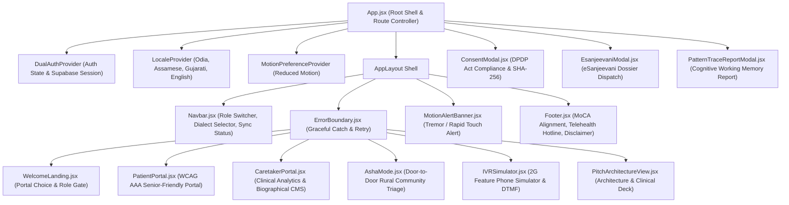
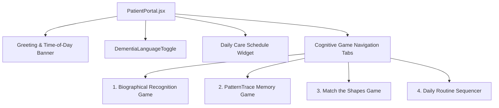
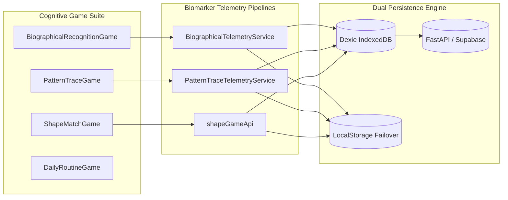
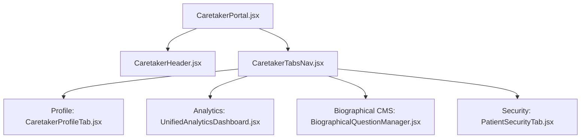

# SmritiSetu Component Architecture Documentation

SmritiSetu is architected as an offline-first, dual-portal cognitive healthcare platform for dementia patients and caregivers in India's North Eastern Region (NER) and rural communities. This document outlines the component hierarchy, domain boundaries, data flow pipelines, and UI composition.

---

## 1. System Component Tree (High-Level)



---

## 2. Global Shell & Navigation Components

### `Navbar.jsx` (`src/components/Navbar.jsx`)
- **Purpose**: Global responsive navigation bar facilitating role transitions between Patient Portal, Caretaker Hub, ASHA Mode, IVR Simulator, and Architecture Deck.
- **Key Subcomponents & Controls**:
  - **Portal Role Switcher**: Visual high-contrast buttons for instant mode toggling.
  - **Dementia Dialect Selector** (`DementiaLanguageToggle.jsx`): Dropdown for regional language switching (Odia `or`, Assamese `as`, Gujarati `gu`, English `en`).
  - **Sync Health Indicator**: Real-time cloud/local sync status indicator (Online / Syncing / Offline Queue) driven by `useSyncEngine`.
  - **Emergency Hotline Badge**: Rapid access phone trigger (`+91 94350 12345`) for caretaker acute crisis assistance.

### `Footer.jsx` (`src/components/Footer.jsx`)
- **Purpose**: Trust anchor and clinical compliance disclosure.
- **Features**: MoCA (Montreal Cognitive Assessment) and ICMR-NARI (National AIDS Research Institute / Neurocognitive) alignment statement, National Health Mission (NHM) and eSanjeevani accreditation notes, and active software versioning.

### `ErrorBoundary.jsx` (`src/components/ErrorBoundary.jsx`)
- **Purpose**: Catches runtime JavaScript errors across lazy routes without crashing the entire clinical application.
- **Fallback UI**: Geriatric-adapted, calm retry button with non-alarming copy and state recovery.

---

## 3. Patient Companion Portal (`src/features/patient`)

### `PatientPortal.jsx` (`src/features/patient/components/PatientPortal.jsx`)
The patient experience is designed for low cognitive load, zero timer stress, and large touch targets (minimum 64px height) satisfying WCAG AAA standards.



#### Core Subcomponents
1. **Time-Based Calming Header**: Displays greeting customized to morning, afternoon, or evening with regional language audio readout (`SpeechSynthesisUtterance` calibrated at 0.88x acoustic cadence).
2. **Today's Care Schedule Routine**: 3-stage visual routine checklist (Morning Hydration, Midday Cognitive Play, Afternoon Stroll) synchronized with the caretaker's daily schedule.
3. **Active Game Renderer**: Lazily switches between the 4 cognitive game engines while preserving patient session context (`patientSession?.patient_id || patientProfile?.id || 1`).

---

## 4. Cognitive Gaming Engines (`src/features/games`)

SmritiSetu includes 4 specialized neurocognitive exercise engines designed specifically for dementia progression monitoring:



### Game 1: Biographical & Family Recognition
- **Component**: `BiographicalRecognitionGame.jsx`
- **Focus**: Relational memory reinforcement, facial/identity recall, autobiographical anchoring.
- **Mechanics**:
  - 4 high-contrast cards displaying family names or life milestones.
  - Soothing instant feedback without punitive red alert states.
  - Relational tiers:
    - `TIER_1_CORE`: Spouse, lifelong residence, primary identity.
    - `TIER_2_CHILD`: Eldest daughter, son's career, grandchildren.
    - `TIER_3_SIBLING`: Childhood siblings, ancestral village roots.
    - `TIER_4_EXTENDED`: Extended relatives and fond nostalgic memories.
  - Telemetry logged: Latency (ms), hesitation movements, mistaken identities.

### Game 2: PatternTrace™ Visuospatial Working Memory
- **Component**: `PatternTraceGame.jsx`
- **Focus**: Visuospatial working memory span, motor coordination, perseverative tracking.
- **Mechanics**:
  - Interactive 3×3 matrix grid with animated node connection demonstration (Phase 2 Demo).
  - Rubber-band SVG drag preview and tactile node-snap feedback (Phase 3 User Input).
  - Adaptive 2-Up / 2-Down Staircase Algorithm (Levels 1 to 5).
  - Standard 5-trial battery with progressive round indicator (`[● ● ○ ○ ○] Trial 2 of 5`).
  - Session complete celebration screen with Working Memory Composite Score, Sequence Recall, Spatial Recall, and Caretaker Sync Confirmation.
  - Mid-session "Take a Rest" safe exit modal.
  - Telemetry logged via `PatternTraceTelemetryService`: Initiation latency, total execution time, sequence match, spatial match, perseveration slips, omission/commission errors.

### Game 3: Match the Shapes (Geometric Discrimination & Motor Tremor)
- **Component**: `ShapeMatchGame.jsx`
- **Focus**: Geometric discrimination, spatial holder alignment, hand-eye motor precision.
- **Mechanics**:
  - 20 SVG vector shapes categorized into 3 progressive tiers:
    - `Tier 1: Basic Polygons` (Circle, Square, Equilateral Triangle, Rectangle, Oval).
    - `Tier 2: Intermediate Figures` (Right Triangle, Diamond/Rhombus, Trapezoid, Pentagon, Hexagon, Star, Crescent, Cross, Heart, Teardrop).
    - `Tier 3: Complex Asymmetric Figures` (Octagon, Parallelogram, Chevron, Semicircle, Clover).
  - Adaptive Hint Escalation: Level 0 (None) -> Level 1 (Gentle Audio Prompt) -> Level 2 (Pulsing Target Outline) -> Level 3 (Soft Magnetic Snap Pull).
  - Motor Tremor Tracking: Calculates trajectory deviations, path jitter ($\text{Jitter} = \sqrt{\Delta x^2 + \Delta y^2}$), and solve duration.

### Game 4: Daily Routine Sequencer
- **Component**: `DailyRoutineGame.jsx`
- **Focus**: Executive function, chronological orientation, Activities of Daily Living (ADL).
- **Mechanics**: Step-by-step card ordering for routine daily events (morning tea, taking medicine, gardening, evening prayer).

---

## 5. Caretaker Clinical Hub (`src/features/caretaker`)



### `CaretakerPortal.jsx` (`src/features/caretaker/components/CaretakerPortal.jsx`)
- **Authentication Gate**: Renders `CaretakerAuthCard.jsx` when unauthenticated, supporting both email/password login and one-click demo credentials.
- **Context Consumer**: Consumes `useCaretakerAnalytics` hook to supply multi-game telemetry across tabs.

### `UnifiedAnalyticsDashboard.jsx` (`src/features/caretaker/components/UnifiedAnalyticsDashboard.jsx`)
Comprehensive clinical dashboard displaying unified multi-game data:
1. **7-Day Cognitive Drift Monitor**:
   - Formula: $\text{Drift \%} = \frac{\bar{L}_{\text{current}} - \bar{L}_{\text{baseline}}}{\bar{L}_{\text{baseline}}} \times 100$
   - Clinical threshold: $\ge 35\%$ triggers prominent amber/rose clinical review warning.
2. **Three-Game Snapshot Cards**: Interactive status tiles for Family Recognition, PatternTrace™ Memory, and Match the Shapes.
3. **Multi-Game Timeline Recharts**:
   - Mode 1: Accuracy (%) comparing all 3 games with green 70% clinical target reference zone.
   - Mode 2: Response Speed (seconds) over active dates.
4. **Game 2 (PatternTrace) Deep Dive**:
   - Working memory step staircase AreaChart.
   - KPI tiles: Sequence Recall, Spatial Recall, Reaction Latency, Perseveration Rate.
   - Working Memory Index (0–100) card and clinical interpretation badge.
   - Logged Trials Table with sequence matching, latency, and perseveration tags.
5. **Game 3 (Match the Shapes) Deep Dive**:
   - Independence score, solve duration, motor jitter/tremor metric.
   - Per-shape difficulty ranking table and confusion pair detection.
6. **Clinical Export Trigger**: Triggers `PatternTraceReportModal` or `EsanjeevaniModal` for clinical consultation.

### `BiographicalQuestionManager.jsx` (`src/features/caretaker/components/BiographicalQuestionManager.jsx`)
- **Purpose**: Caregiver CMS allowing family members to add, edit, reorder, or delete personalized memory questions.
- **Capabilities**: Option distractor generation, relation tier selection, local storage backup, and instant IndexedDB synchronization.

---

## 6. Community Health & Telephony Access Components

### `AshaMode.jsx` (`src/features/asha/components/AshaMode.jsx`)
- **Target Persona**: Accredited Social Health Activists (ASHA workers) performing door-to-door rural field screenings.
- **Capabilities**:
  - Offline patient queue with triage tagging (`Green: Stable`, `Amber: Review Needed`, `Red: Clinical Alert`).
  - Rapid cognitive screening questions and qualitative field notes.
  - Automatic background synchronization when mobile connectivity resumes.

### `IVRSimulator.jsx` (`src/features/ivr/components/IVRSimulator.jsx`)
- **Target Persona**: Rural elderly elders using 2G feature phones without internet or touchscreen access.
- **Capabilities**:
  - Interactive DTMF telephone keypad with realistic audio tones.
  - Multi-step voice prompt simulator evaluating time-of-day orientation and memory recall.
  - Telemetry logging mapped to backend `/api/v1/ivr/process-input`.

### `EsanjeevaniModal.jsx` (`src/features/teleconsult/components/EsanjeevaniModal.jsx`)
- **Purpose**: Direct integration with the Government of India's national telemedicine platform (eSanjeevani).
- **Capabilities**: Pre-populates patient ABHA ID, 7-day cognitive drift percentage, motor jitter metrics, and dispatches clinical summaries directly to assigned medical officers.

### `ConsentModal.jsx` (`src/features/consent/components/ConsentModal.jsx`)
- **Compliance**: Digital Personal Data Protection (DPDP) Act 2023.
- **Capabilities**: Granular checkboxes for telemetry collection, voice recording storage, and ABHA linkage, signed with a client-generated cryptographic SHA-256 session hash.

---

## 7. State Management & Data Flow Architecture

### Dual-Layer Storage Pattern
```
[User Action in Game / CMS]
            │
            ▼
   [Component State]
            │
            ├─────────────────────────────────────────────┐
            ▼                                             ▼
 [Dexie IndexedDB (Primary)]                  [LocalStorage Backup]
 (patterntrace_trials, biographical_trials,   (Failover cache for zero loss)
  shape_game_sessions, telemetry)                         │
            │                                             │
            ├─────────────────────────────────────────────┘
            ▼
  [BroadcastChannel('smritisetu_sync')]  ──►  [Caretaker Dashboard (Instant Refresh)]
            │
            ▼
[useSyncEngine / Online Detector]
            │
            ▼ (HTTP Batch POST)
[FastAPI / Supabase PostgreSQL (/api/v1/telemetry/sync)]
```

### Key Custom Hooks
| Hook | Path | Purpose |
| :--- | :--- | :--- |
| `useCaretakerAnalytics` | `src/features/caretaker/hooks/useCaretakerAnalytics.js` | Fetches, computes, and combines multi-game telemetry, trends, drift, and timelines with real-time `BroadcastChannel` and `visibilitychange` listeners. |
| `useDualAuth` | `src/features/auth/context/DualAuthContext.jsx` | Manages caretaker Supabase session, patient profile state, and patient login credentials. |
| `useLocale` | `src/features/localization/context/LocaleContext.jsx` | Manages active regional dialect and auto-detects user region. |
| `useAshaTriage` | `src/features/asha/hooks/useAshaTriage.js` | Manages local ASHA screening records and queue syncing. |
| `useConsent` | `src/features/consent/hooks/useConsent.js` | Validates DPDP consent compliance before telemetry ingestion. |
